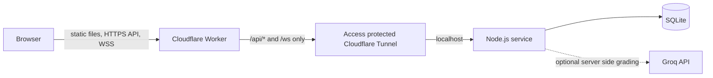

# ITK-BGSV Prompt Works

ITK-BGSV is a browser based engineering training game built with Three.js. This repository includes the full game, the Node.js multiplayer and progress service, the Cloudflare Worker proxy, tests, deployment templates, and contributor documentation.

## Start here

The active Phase 3 implementation is in [`phase3-work/`](phase3-work/). Start there for current game, backend, Worker, and test changes. The root `server/` and `index.html` are the earlier project baseline; root `cloudflare-game/` is an earlier static deployment snapshot kept for reference. They are not the current frontend source.

The latest documented production state and movement recovery are in [`phase3-work/PRODUCTION-DEPLOYMENT-STATUS.md`](phase3-work/PRODUCTION-DEPLOYMENT-STATUS.md). That operational record is dated 2026-11-12, so check the live service and update the record before relying on its status or version identifiers.

The game preserves the 3D engineering office, nine local NPCs, eight missions, English and Vietnamese content, desktop keyboard movement, mobile controls, and jump. Multiplayer uses server validated WebSocket movement and guest sessions. The browser remembers the display name; a separate opaque server cookie identifies a guest and restores saved progress. A display name is not an authentication credential.

## Repository map

| Path | Purpose |
| --- | --- |
| `phase3-work/index.html` | Editable main game and 3D scene source |
| `phase3-work/cloudflare-game/phase3-ui.js` | Guest, progress, mission, and game UI integration |
| `phase3-work/cloudflare-game/mission-templates.json` | Editable English and Vietnamese answer scaffolds |
| `phase3-work/cloudflare-game/public/` | Prepared static frontend assets served by Workers Static Assets |
| `phase3-work/cloudflare-game/src/worker.js` | Same-origin `/api/*` and `/ws` proxy |
| `phase3-work/server/` | Node.js HTTP API, accounts, SQLite storage, grading queue, and multiplayer room |
| `phase3-work/tests/` | Automated unit, API, persistence, Worker proxy, and WebSocket tests |
| `phase3-work/tools/` | Local operations, browser checks, and load-test helpers |
| `phase3-work/deploy/` | systemd and backup templates; review before adapting to a host |
| `phase3-work/*.md` | Architecture, schema, security, deployment, release, and verification documentation |
| `cloudflare-game/` | Earlier static frontend deployment snapshot, retained for comparison |
| `server/`, `index.html`, `tests/`, `docs/` | Original project baseline; retained and unchanged by Phase 3 |

`phase3-work/cloudflare-game/prepare.mjs` builds `public/` from the editable game source, UI code, mission templates, and locally installed Three.js package. Make source changes first, then regenerate assets with `npm run prepare:assets` from `phase3-work/cloudflare-game/`. Review the generated asset manifest before any release.

## Architecture



Static game files use Cloudflare Workers Static Assets. Only `/api/*` and `/ws` pass through the Worker handler. The browser uses the game Worker hostname for both HTTP and WebSockets; Access service credentials and the backend proxy secret stay in protected configuration. The Node.js service owns identity, progress, movement validation, submissions, reviews, and XP. SQLite is stored outside the public asset directory.

Local and test environments default to mock grading, which does not award verified XP. Production grading configuration is deployment specific; inspect the latest deployment status and protected server configuration rather than assuming that staging or local settings match production. Never put provider credentials in frontend code, examples, test output, or Git.

## Develop locally

Requirements: Node.js 24.7 or newer and npm. Use Node 24 for the current Phase 3 backend because it relies on built in Argon2id support.

```sh
cd phase3-work
npm ci
npm test
```

The test command builds the TypeScript backend and runs the automated suite using Node's test runner. It uses isolated test data. For a local backend, build first, configure a local-only `.env` based on `.env.example`, and start it with:

```sh
npm start
```

The backend defaults to `127.0.0.1:3000`. Keep local database paths and proxy secrets separate from staging and production. For the local Worker preview and full local proxy setup, follow [`phase3-work/cloudflare-game/README.md`](phase3-work/cloudflare-game/README.md) and [`phase3-work/DEPLOYMENT-GUIDE.md`](phase3-work/DEPLOYMENT-GUIDE.md). Do not copy live credentials into `.env` or `.dev.vars`.

To prepare and preview the static Worker frontend:

```sh
cd phase3-work/cloudflare-game
npm ci
npm run prepare:assets
npm run dev
```

The default preview is frontend only; it does not prove multiplayer, persistence, or grading. For integrated local API and WebSocket checks, follow the Worker README.

## Test and verification commands

From `phase3-work/`:

```sh
npm test
npm run test:browser
npm run load
```

`npm run test:browser` requires the documented browser runtime. `npm run load` starts an isolated local mock service and its generated reports are local artifacts. Read `LOAD-TEST-RESULTS.md` before interpreting any load result: a loopback test is not evidence of public Cloudflare-to-Oracle capacity. The external Windows runner and its safe limits are documented in [`phase3-work/windows-load-test/README.md`](phase3-work/windows-load-test/README.md).

Do not run live grading/evaluation scripts as routine tests. They may submit data to an external provider. Use synthetic answers only and obtain the project owner's approval before any paid or production operation.

## Data and safety

- Never commit `.env`, `.dev.vars`, credentials, session cookies, SQLite databases, private keys, Wrangler state, or real player answers.
- Use synthetic names, profiles, and submissions in tests.
- Do not expose the Node listener publicly; route it through the approved Cloudflare Tunnel and Access configuration.
- Do not change production Worker `game`, production services/data, DNS, Tunnel, Access, SSH, firewall, or telemetry Workers without explicit owner approval.
- Groq and production grading are deployment configuration. Do not enable, replace, or call an AI provider without explicit approval.
- Local SQLite backups are part of the demo. Catastrophic host or disk loss may erase demo progress; that risk is accepted.

See [`CONTRIBUTING.md`](CONTRIBUTING.md) for the source-of-truth map and workflow for future contributors.

## License

This repository does not currently declare a project license. Ask the maintainer before reusing or redistributing the game. The bundled Three.js library has its own license in `phase3-work/cloudflare-game/public/vendor/three.LICENSE.txt`.
